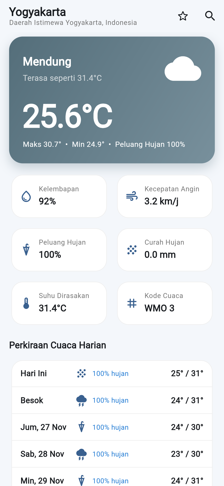
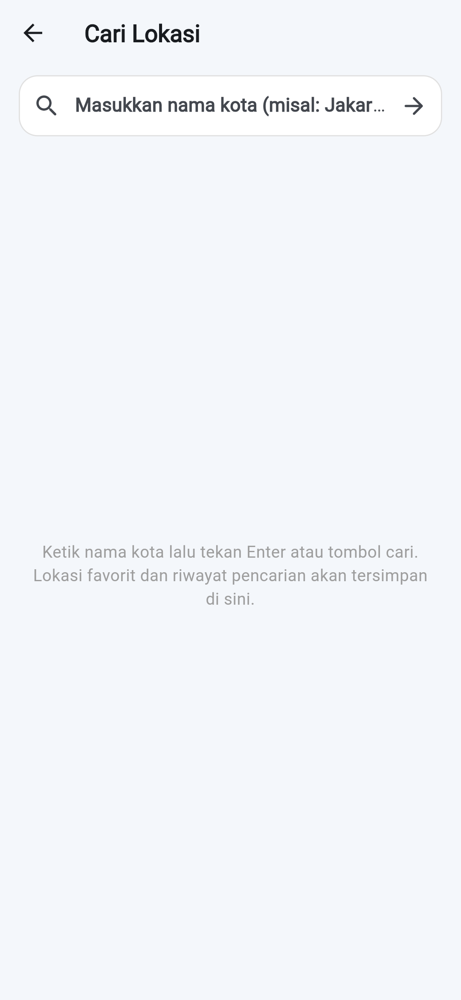

# Weather App — Responsi Flutter

Aplikasi prakiraan cuaca berbasis Flutter menggunakan **Open-Meteo REST API** dengan pola arsitektur **Model-View-ViewModel (MVVM)**, state management **Provider**, dan penyimpanan lokal **SharedPreferences**.

## Fitur Utama

1. **Home / Weather Screen**
   - Menampilkan nama kota yang sedang dipilih beserta wilayah/negara.
   - Menampilkan kondisi cuaca terkini (ikon & deskripsi berdasarkan WMO `weather_code`), suhu saat ini, serta suhu yang dirasakan.
   - Menampilkan informasi detail: kelembapan udara, kecepatan angin, curah hujan, peluang hujan maksimum, dan kode cuaca.
   - Menampilkan perkiraan cuaca harian (7 hari ke depan: suhu minimum, suhu maksimum, dan peluang hujan).
   - Pull-to-refresh untuk memperbarui data cuaca langsung dari API.
   - Quick-switch bar untuk berpindah cepat antar lokasi favorit.

2. **Search / Location Screen**
   - Pencarian kota secara langsung melalui **Open-Meteo Geocoding API**.
   - Menyimpan dan menampilkan **Lokasi Favorit** serta **Riwayat Pencarian** menggunakan `SharedPreferences` (tetap tersimpan saat aplikasi ditutup dan dibuka kembali).
   - Penanganan state *loading*, *empty state*, dan *error* dengan tombol coba lagi.

## Struktur Aplikasi (MVVM)

```text
lib/
├── main.dart                         # Entry point & MultiProvider setup
├── models/
│   ├── location_model.dart           # Model data lokasi kota (Geocoding & Storage)
│   └── weather_model.dart            # Model data cuaca terkini & harian
├── services/
│   ├── weather_api_service.dart      # HTTP GET request ke Open-Meteo API
│   └── local_storage_service.dart    # Penyimpanan lokal (SharedPreferences)
├── viewmodels/
│   ├── weather_viewmodel.dart        # State & logic untuk Home/Weather Screen
│   └── search_viewmodel.dart         # State & logic untuk Search/Location Screen
├── views/
│   ├── home_weather_screen.dart      # UI layar utama cuaca
│   └── search_location_screen.dart   # UI layar pencarian & favorit
├── theme/
│   └── app_theme.dart                # Material 3 ThemeData & Typography
└── utils/
    └── weather_code_helper.dart      # Mapping WMO weather_code & format tanggal
```

### Penerapan MVVM
- **Model (`models/`)**: Merepresentasikan struktur data JSON dari API menjadi objek Dart (`LocationModel`, `WeatherModel`, `CurrentWeather`, `DailyForecast`).
- **View (`views/`)**: Widget Flutter yang hanya bertugas menampilkan UI dan mendengarkan perubahan state dari ViewModel melalui `Consumer`.
- **ViewModel (`viewmodels/`)**: Menggunakan `ChangeNotifier` (`Provider`) sebagai penghubung antara `Services` dan `View`, mengelola state `isLoading`, `errorMessage`, data cuaca, daftar favorit, serta riwayat pencarian.

## Implementasi API (Open-Meteo)

1. **Geocoding API**
   - Endpoint: `https://geocoding-api.open-meteo.com/v1/search`
   - Parameter: `name`, `count=10`, `language=id`, `format=json`
2. **Weather Forecast API**
   - Endpoint: `https://api.open-meteo.com/v1/forecast`
   - Parameter: `latitude`, `longitude`, `timezone=auto`
   - `current`: `temperature_2m`, `relative_humidity_2m`, `apparent_temperature`, `precipitation`, `weather_code`, `wind_speed_10m`
   - `daily`: `weather_code`, `temperature_2m_max`, `temperature_2m_min`, `precipitation_probability_max`

## Screenshot Aplikasi

| Home / Weather Screen | Search / Location Screen |
| :---: | :---: |
|  |  |

### Deskripsi Tampilan

**Home / Weather Screen**
- Menampilkan nama kota aktif (contoh: *Yogyakarta, Daerah Istimewa Yogyakarta, Indonesia*) di AppBar beserta tombol favorit (⭐) dan tombol cari (🔍).
- Card cuaca utama dengan gradien biru menampilkan: ikon kondisi cuaca, deskripsi (misal: *Mendung*), suhu saat ini dalam format besar (`25.6°C`), suhu yang dirasakan, serta ringkasan suhu min–maks dan peluang hujan hari ini.
- Grid 2 kolom berisi metrik detail: Kelembapan, Kecepatan Angin, Peluang Hujan, Curah Hujan, Suhu Dirasakan, dan Kode Cuaca.
- Daftar perkiraan cuaca 7 hari ke depan (nama hari, ikon, peluang hujan, suhu min/maks).
- Pull-to-refresh untuk memuat ulang data dari API.

**Search / Location Screen**
- Input teks dengan ikon pencarian untuk mencari nama kota ke Open-Meteo Geocoding API.
- Menampilkan **Riwayat Pencarian** (maks. 10 entri) saat input kosong, dengan tombol hapus seluruh riwayat.
- Hasil pencarian ditampilkan sebagai daftar card berisi nama kota, wilayah, koordinat, dan tombol bintang untuk menyimpan/menghapus favorit.
- State loading dengan `CircularProgressIndicator`, state error dengan pesan dan tombol coba lagi.

## Video Penjelasan Aplikasi

Tonton video demo dan penjelasan kode aplikasi di YouTube:
- [Video Penjelasan Aplikasi (YouTube)](https://youtu.be/Y7985ggX6no?si=aKWBnjEseOqDGr59)

## Cara Menjalankan

```bash
flutter pub get
flutter run
```
